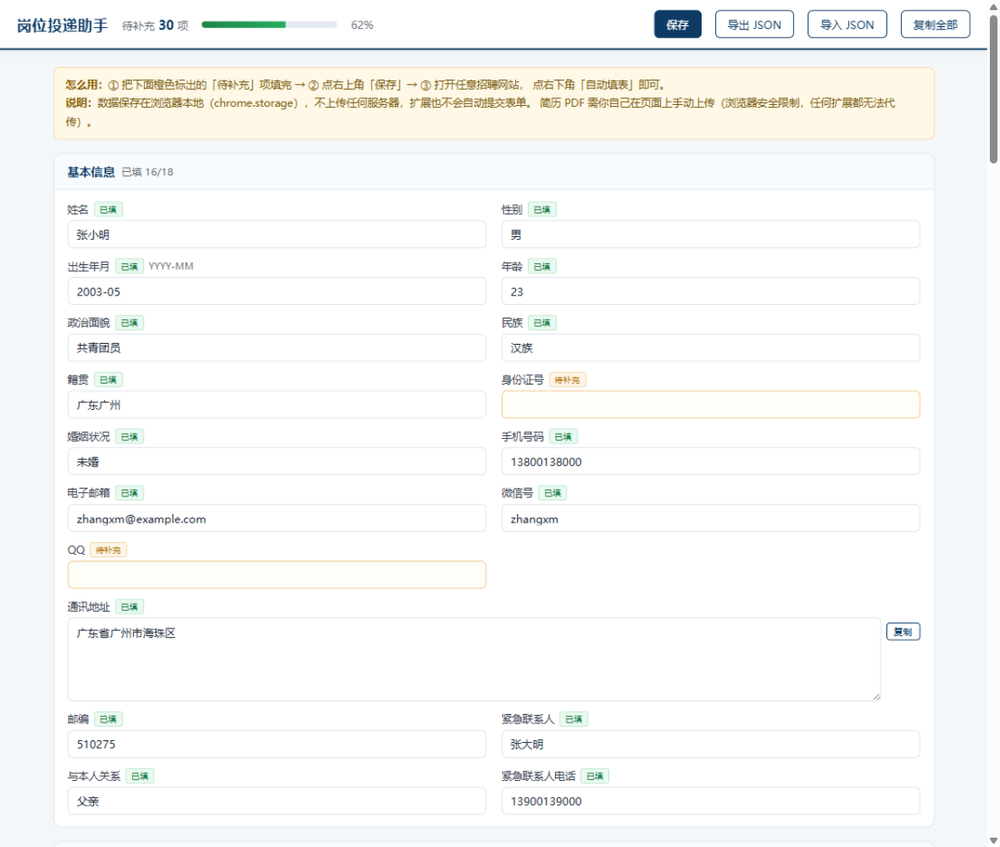
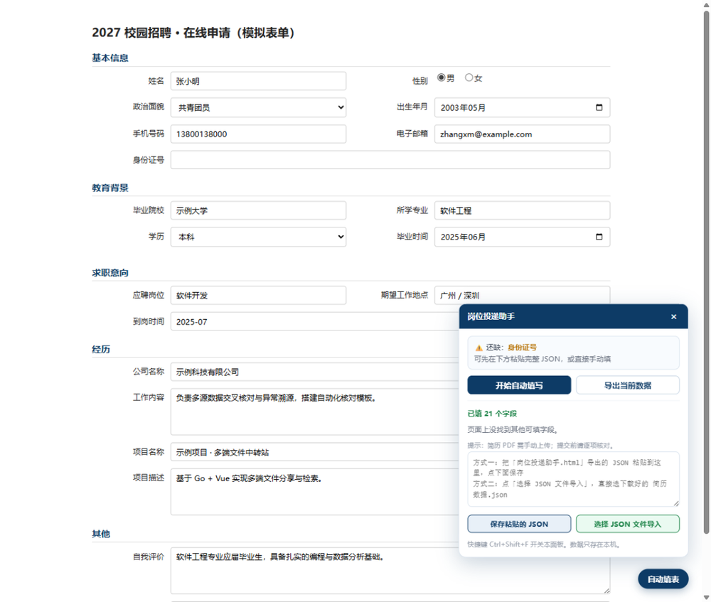

# 岗位投递助手 · Job Application Autofill

> 一个帮你自动填写招聘网站网申表单的浏览器扩展。填一次简历数据，之后在所有招聘站点一键填充。

<p align="center">
  
</p>

<p align="center">
  
  
  
  
</p>

---

## 这个项目解决什么问题

国内校招网申表单普遍冗长：姓名、身份证、籍贯、学历、GPA、四六级、实习经历、项目经历、自我评价……同一份信息要在几十个网站上重复填几十遍。

浏览器自带的自动填充只认「地址/信用卡」，对「政治面貌」「所学专业」「紧急联系人」这类中文字段无能为力。

本项目做的事：**按字段语义自动识别并填写**，同时把没识别出来的字段列给你，避免漏填。

---

## 功能

| 能力 | 说明 |
|---|---|
| **语义识别** | 不依赖固定选择器，靠 label / placeholder / name / id 的语义匹配，适配各站点不同写法 |
| **多控件支持** | 文本框、多行文本、下拉框（按选项文字匹配）、单选按钮、日期/月份控件 |
| **框架兼容** | 用原生 setter + `input/change/blur` 事件写入，兼容 React / Vue 受控组件（北森、Moka、飞书招聘、hotjob 等） |
| **结果可视化** | 填完高亮显示哪些字段被填了，并列出未识别的字段供手动补充 |
| **数据本地化** | 数据只存在浏览器本地 `chrome.storage`，不联网、不上传 |
| **不自动提交** | 只填不交，提交必须由你本人核对后点击 |

### 效果

**① 数据填写页**：78 个字段分 10 个分区，橙色边框标出待补充项，顶部显示完成度。



**② 一键填表**：在网申页面点「开始自动填写」，填过的字段高亮，未识别的字段列在面板上。




### 覆盖字段

- **基本信息**：姓名、性别、出生年月、年龄、政治面貌、民族、籍贯、身份证号、婚姻状况、手机、邮箱、微信、QQ、通讯地址、邮编、紧急联系人
- **教育背景**：毕业院校、学院、专业、学历、学位、入学/毕业时间、GPA、专业排名、英语四级、英语六级、主修课程
- **求职意向**：应聘岗位、期望城市、期望薪资、到岗时间
- **经历**：公司名称、职位、工作内容、项目名称、项目角色、项目描述
- **主观题**：自我评价、自我介绍、职业规划、优势、不足、最有挑战的事

---

## 安装

### 方式一：从源码构建（推荐）

```bash
git clone <repo-url>
cd job-application-autofill

# 生成图标（首次）
python scripts/make_icons.py

# 构建
python scripts/build.py
```

然后在浏览器中：

1. 打开 `chrome://extensions`（Edge 为 `edge://extensions`）
2. 打开右上角 **开发者模式**
3. 点 **加载已解压的扩展程序**
4. 选择项目下的 `dist/` 目录

> 依赖：Python 3.8+，生成图标需要 `Pillow`（`pip install pillow`）。构建本身只用标准库。

### 方式二：直接使用 dist/

仓库已包含构建好的 `dist/`，直接执行上面第 1–4 步、选择 `dist/` 即可。

---

## 使用

### 1. 填写你的简历数据

首次安装会自动打开数据填写页（也可以点扩展图标 → 右键 → 选项）。

页面把 78 个字段分成 10 个分区，橙色边框的是「待补充」。填完点右上角 **保存**。

> 数据存在 `chrome.storage.local`，刷新、重启浏览器都不会丢。

### 2. 在招聘网站上一键填写

打开任意网申页面：

- 点右下角蓝色 **自动填表** 按钮，或
- 点浏览器工具栏的扩展图标，或
- 按 `Ctrl + Shift + F`

面板里点 **开始自动填写**。填过的字段会短暂显示绿色边框，未识别的字段会列在面板上。

### 3. 手动收尾

- **上传简历 PDF**（扩展无法代传）
- 补充面板提示的未填字段
- **逐项核对后手动提交**

---

## 工作原理

```
src/
├── manifest.json          MV3 配置
├── sw.js                  Service Worker：首次安装打开选项页、图标点击唤起面板
├── options.html           数据填写页（78 字段表单）
├── content.js             内容脚本入口
├── core/
│   ├── config.js          常量（存储键、DOM id）
│   ├── default-profile.js 默认数据结构（空模板）
│   ├── utils.js           存储读写、深合并、路径取值/赋值、语义上下文采集
│   ├── rules.js           ★ 字段匹配规则表
│   └── filler.js          填充引擎（pickRule / pickOption / normalizeDateValue 为纯函数）
└── ui/
    └── panel.js           页内面板 UI

test/
├── cases.js               测试用例（环境无关，Node 与浏览器共用）
├── core.test.js           Node 入口，CI 跑这个
└── browser-check.html     浏览器入口，无 Node 时本地手测用

scripts/
├── build.py               按依赖顺序拼接模块 → dist/
├── make_icons.py          生成 16/32/48/128 图标
└── check_no_pii.py        隐私守卫：确认默认模板为空、无硬编码联系方式
```

构建脚本把上述模块按依赖顺序拼接成一个 IIFE（`dist/content.js`），避免引入打包器。

### 开发与测试

```bash
python scripts/check_no_pii.py   # 隐私守卫
node --test test/                # 单元测试（24 个用例）
python scripts/build.py          # 构建
npm run verify                   # 以上三步串起来
```

没有 Node 环境时，直接用浏览器打开 `test/browser-check.html` 也能跑同一份断言（用例在 `test/cases.js`，两边共用）。

单测覆盖的关键点：
- 字段识别（含「紧急联系人不能被通用手机号规则抢走」这类回归用例）
- 下拉选项匹配（精确 / 包含 / 反向包含）
- 日期归一化（`2027/6`、`2027年6月` → `2027-06`）
- 深合并、路径取值/赋值
- 规则表完整性、默认模板必须为空（隐私守卫）

### 字段识别是怎么做的

核心是 `src/core/rules.js` 里的规则表：

```js
{ path: "basic.phone", re: /手机|移动电话|联系电话|联系方式|phone|mobile|\btel\b/ }
```

对每个输入框，收集它的「语义上下文」：

1. `name` / `id` / `placeholder` / `aria-label` / `title`
2. `<label for="id">` 的文字
3. 包裹它的 `<label>` 文字
4. 同一父节点下的 `<label>` 兄弟文字
5. 最近一层表单项容器（`.ant-form-item` / `.el-form-item` / `.form-item` 等）里的 label

然后用规则表**按顺序**匹配，第一条命中即采用。

> ⚠️ 注意：**不能**把祖先容器（form/body）的整段文字算进上下文——否则「性别」这类词会污染所有字段。这是 v1 踩过的坑，已在 v2 修正。

---

## 已知限制

诚实列出，避免误导：

| 限制 | 原因 | 状态 |
|---|---|---|
| 不能上传简历 PDF | 浏览器安全机制禁止脚本操作 file input | 无解，需手动 |
| 不能登录 / 过验证码 | 同上，且属绕过安全机制 | 不做 |
| 不自动提交 | 投递不可逆，必须人工确认 | 设计如此 |
| iframe 内嵌表单识别不到 | 当前只注入顶层 frame | 见 Roadmap |
| 富文本编辑器、级联选择器、树形下拉填不进 | 非标准 input | 见 Roadmap |
| 个别站点字段写法特殊会漏识别 | 语义匹配有上限 | 面板会列出，手动补 |

**每次投递前请务必逐项核对，尤其是身份证号、手机号、期望岗位。**

---

## 隐私

- 所有数据存于 `chrome.storage.local`，**不发送到任何服务器**
- 扩展不包含任何远程代码，不加载外部脚本
- 不采集任何使用统计
- 唯一申请的权限是 `storage`（存数据）和 `scripting`（在页面注入脚本）
- `host_permissions` 为 `http/https` 全站，因为需要在你访问的任意招聘页面上工作；**不会读取页面内容并外传**

> 如果你介意全站权限，可以自行改为 `activeTab` 按需注入模式（见 Roadmap）。

---

## Roadmap

### P0 · 发布前必须

- [x] 补充单元测试（字段匹配规则、日期归一化、下拉匹配）—— 24 个用例，CI 已接入
- [x] 隐私守卫脚本（默认模板为空、无硬编码联系方式）
- [x] 图标与 README 截图
- [x] 隐私政策页面（上架商店要求）
- [ ] 代码格式化统一（`npx prettier --write "src/**/*.{js,html,json}"`）—— 配置已就绪，尚未跑过一遍

### P1 · 明显提升可用性

- [ ] **站点适配器**：为北森 / Moka / 飞书招聘 / hotjob 等写专用适配器，替代纯启发式匹配
- [ ] iframe 支持（`all_frames: true` + 跨 frame 汇总结果）
- [ ] 富文本编辑器支持（contenteditable）
- [ ] 级联选择器 / 树形下拉支持
- [ ] 多套简历数据切换（技术版 / 游戏版 / 国企版）
- [ ] 导入 `.docx` / `.pdf` 简历自动解析出字段

### P2 · 锦上添花

- [ ] 改为 `activeTab` 按需注入，去掉全站权限
- [ ] Firefox 支持（`browser.*` polyfill + MV3 差异处理）
- [ ] 数据加密存储（身份证号等敏感字段）
- [ ] 字段规则可视化编辑器
- [ ] i18n（英文界面）

---

## 贡献

欢迎 PR，尤其是**站点适配器**和**字段规则补充**。详见 [CONTRIBUTING.md](CONTRIBUTING.md)。

最有价值的贡献是：遇到某个网站填不进去，把该网站的字段结构（label 文字 + name + 控件类型）提 issue，我们把它加进 `rules.js`。

---

## License

[MIT](LICENSE)
